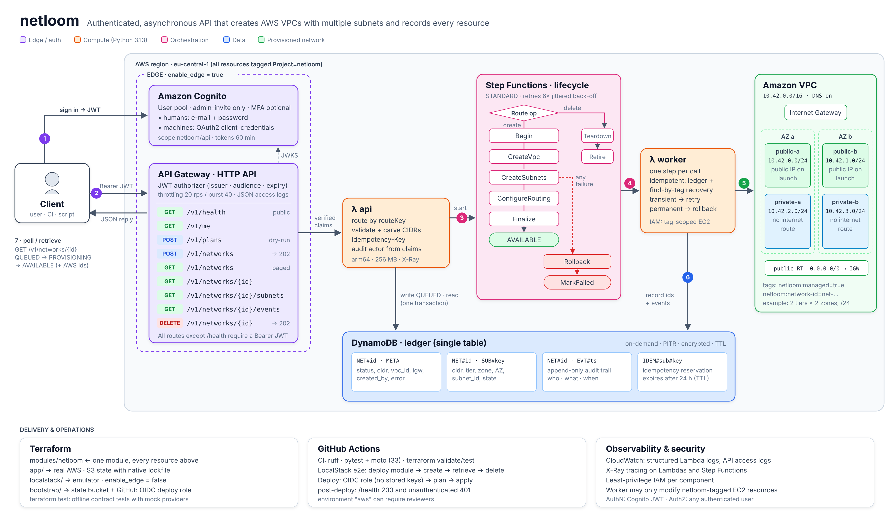

# netloom

An authenticated REST API that **creates AWS VPCs with multiple subnets**, **records every resource it creates**, and lets any signed-in user **retrieve** that data later. It's written in Python and runs entirely on AWS serverless services. The same Terraform module deploys it to **LocalStack** on your laptop, with no AWS account, or to real AWS through GitHub Actions with no stored keys.

```
POST /v1/networks  ──►  202 Accepted (QUEUED)  ──►  Step Functions builds VPC + subnets + IGW
GET  /v1/networks/{id}                          ◄──  AVAILABLE, with every AWS id recorded
```

| Requirement | How netloom meets it |
|---|---|
| API that creates a VPC with multiple subnets | `POST /v1/networks`: list subnets explicitly, or describe a *layout* (tiers × zones) and let the planner carve the CIDRs |
| Store the results | DynamoDB single-table ledger: network, one item per subnet, append-only audit events |
| Retrieve created resources | `GET /v1/networks`, `/{id}`, `/{id}/subnets`, `/{id}/events` |
| Python | Python 3.13 Lambda functions, standard library + boto3 only |
| Authentication layer | Amazon Cognito user pool. API Gateway verifies the JWT before any code runs |
| Authorization open to all authenticated users | One JWT authorizer, no scopes or ownership checks. Writes still record *who* did them |
| Bonus: automation | Terraform for all infrastructure, a bootstrap stack for remote state and GitHub OIDC, and CI/CD that tests, deploys and health-checks |
| Local emulation | The same Terraform module deploys to **LocalStack**. `make local-e2e` runs create → retrieve → delete end to end, and `make local-gateway` serves Swagger UI on `localhost:8080`, all without an AWS account |

---

## Architecture



- **Asynchronous.** The API validates the request, records it and returns `202`. A Step Functions workflow then builds the VPC with retries, back-off and automatic rollback, and clients poll the record.
- **Retry-safe.** DynamoDB is the ledger, and every AWS resource is tagged `netloom:network-id`. If a step crashes mid-way, the retry *adopts* what was already built instead of duplicating it.
- **Least privilege.** The worker can only create, modify or delete EC2 resources tagged `netloom:managed=true`.
- **One Terraform module, two targets:** `infra/localstack` (emulator) and `infra/app` (AWS).

Design decisions and trade-offs: [docs/architecture.md](docs/architecture.md).

## Quick start (LocalStack, no AWS account)

Requires Python **3.12+**, Terraform 1.10+ and Docker Desktop.

```bash
python3.13 -m venv .venv && source .venv/bin/activate && pip install -r requirements-dev.txt
export LOCALSTACK_IMAGE=localstack/localstack:4.14   # or: export LOCALSTACK_AUTH_TOKEN=... (free plan)
make local-e2e        # start LocalStack, terraform apply, run create → retrieve → delete end to end
make local-gateway    # Swagger UI → http://localhost:8080/docs  (Authorize with: local-alice)
make local-down       # stop and discard everything
```

`make check` runs everything CI runs, all offline: lint, 40 pytest tests and the Terraform contract tests. `make help` lists all targets.

To deploy to real AWS, run `make bootstrap REPO=<owner>/<repo>`, then `make init deploy`, or let GitHub Actions deploy it. See [docs/RUNNING.md](docs/RUNNING.md#aws-optional).

## Documentation

| Document | Contents |
|---|---|
| [docs/API.md](docs/API.md) | Endpoints, request/response conventions, subnet definitions, auth, curl walkthrough |
| [docs/RUNNING.md](docs/RUNNING.md) | LocalStack setup in detail, troubleshooting, AWS deployment, demo script, operations, limitations |
| [docs/architecture.md](docs/architecture.md) | Request flow, data model, design decisions, failure handling, security |
| [docs/openapi.yaml](docs/openapi.yaml) | OpenAPI 3.1 contract, also served at `/v1/openapi.json` and rendered at `/docs` |

## Repository layout

```
src/netloom/
  api.py            HTTP handler: routing by routeKey, validation, idempotency, 202 flow
  planner.py        pure CIDR planning/validation (also powers the dry-run)
  store.py          DynamoDB single-table repository, optimistic status transitions
  provisioner.py    Step Functions worker: idempotent EC2 steps, tag discovery, rollback
  docs.py           Swagger UI page + OpenAPI document endpoints
  openapi.json      compiled from docs/openapi.yaml (make openapi), shipped in the Lambda
  web.py ids.py errors.py
infra/
  modules/netloom/  the stack itself: Cognito, HTTP API, Lambdas, Step Functions, DynamoDB, IAM
    tests/          terraform test contract tests (mock providers, offline)
  localstack/       root for LocalStack: endpoint overrides, local state, docker-compose.yml
  app/              root for real AWS: provider, S3 backend, module call
  bootstrap/        one-time AWS setup: S3 state bucket + GitHub OIDC deploy role
scripts/
  local_smoke.py    end-to-end run against the LocalStack deployment
  local_gateway.py  API Gateway stand-in for LocalStack (Swagger UI on :8080, dev tokens)
  build_openapi.py  docs/openapi.yaml -> src/netloom/openapi.json
  netloom_auth.py   AWS only: add users, sign in, machine tokens (reads terraform outputs)
  smoke_test.sh     AWS only: end-to-end demo against a live deployment
tests/              pytest + moto: planner, API, workflow, OpenAPI contract (40 tests)
docs/               architecture & decisions, diagram, OpenAPI 3.1 spec
.github/workflows   ci.yml (lint, tests, tf validate/test, LocalStack e2e) · deploy.yml (AWS)
```
