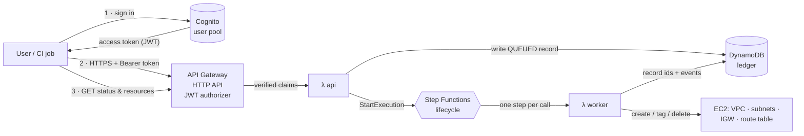
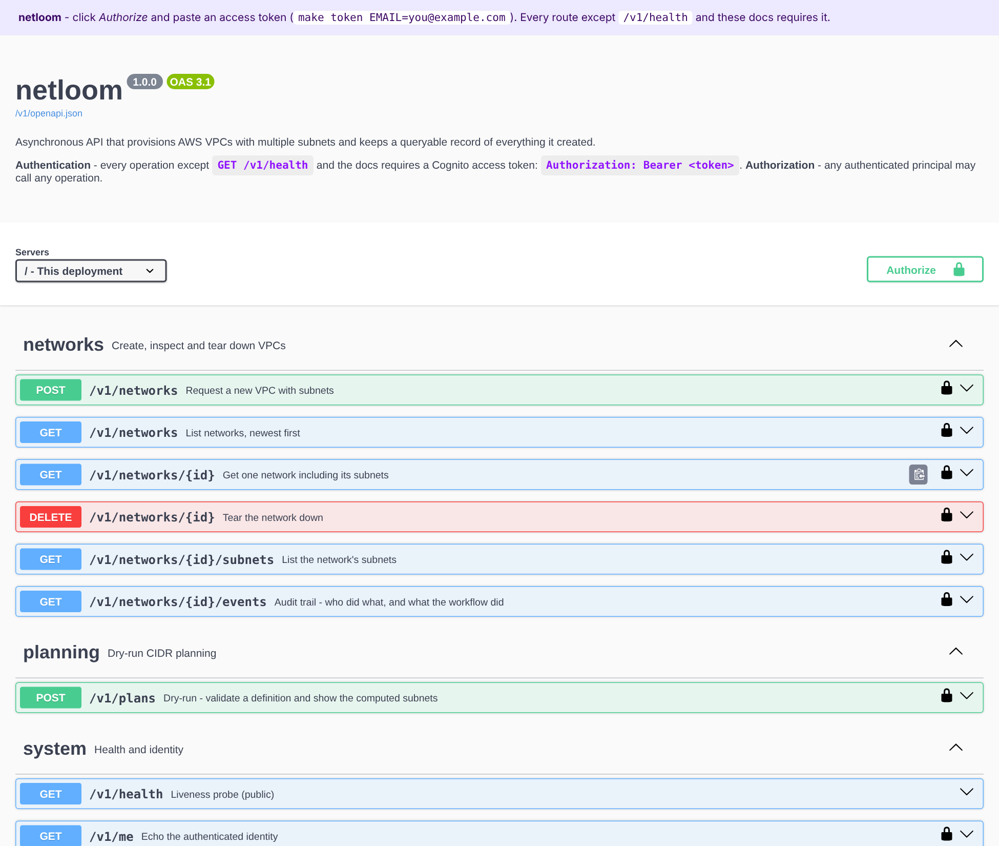

# netloom

An authenticated REST API that **creates AWS VPCs with multiple subnets**, **records every resource it creates**, and lets any signed-in user **retrieve** that data later. It's written in Python and runs entirely on AWS serverless services. The same Terraform module deploys it to **LocalStack** on your laptop, with no AWS account, or to real AWS through GitHub Actions with no stored keys.

```
POST /v1/networks  ──►  202 Accepted (QUEUED)  ──►  Step Functions builds VPC + subnets + IGW
GET  /v1/networks/{id}                          ◄──  AVAILABLE, with every AWS id recorded
```

| Requirement | How netloom meets it |
|---|---|
| API that creates a VPC with multiple subnets | `POST /v1/networks`: list subnets explicitly, or describe a *layout* (tiers × zones) and let the planner carve the CIDRs |
| Store the results | DynamoDB single-table ledger: network, one item per subnet, append-only audit events |
| Retrieve created resources | `GET /v1/networks`, `/{id}`, `/{id}/subnets`, `/{id}/events` |
| Python | Python 3.13 Lambda functions, standard library + boto3 only |
| Authentication layer | Amazon Cognito user pool. API Gateway verifies the JWT before any code runs |
| Authorization open to all authenticated users | One JWT authorizer, no scopes or ownership checks. Writes still record *who* did them |
| Bonus: automation | Terraform for all infrastructure, a bootstrap stack for remote state and GitHub OIDC, and CI/CD that tests, deploys and health-checks |
| Local emulation | The same Terraform module deploys to **LocalStack**. `make local-e2e` runs create → retrieve → delete end to end, and `make local-gateway` serves Swagger UI on `localhost:8080`, all without an AWS account |

---

## Architecture


<sub>Source: [docs/architecture.svg](docs/architecture.svg). The diagrams below are the Mermaid versions that GitHub renders.</sub>



**Why it's asynchronous.** Building a VPC takes several dependent EC2 calls. Any of them can be throttled or fail, and a partial failure must be cleaned up. If one HTTP request did all of that, the client would wait on a long call and orphaned resources could be left behind. Here the API only validates, records and enqueues. A Step Functions workflow does the work with retries, back-off and automatic rollback, and the client polls a resource that always reflects the truth.

### Lifecycle

```mermaid
stateDiagram-v2
    [*] --> QUEUED: POST /v1/networks
    QUEUED --> PROVISIONING: Begin
    PROVISIONING --> AVAILABLE: CreateVpc → CreateSubnets → ConfigureRouting → Finalize
    PROVISIONING --> FAILED: any step fails → Rollback (deletes what was built)
    AVAILABLE --> DECOMMISSIONING: DELETE
    FAILED --> DECOMMISSIONING: DELETE (cleans leftovers)
    DECOMMISSIONING --> DELETED: Teardown → Retire
    DECOMMISSIONING --> FAILED: teardown blocked (e.g. user put an EC2 instance in it)
```



Every step can be retried safely:

- **DynamoDB is the ledger.** Each step reads the record first and skips work that's already recorded.
- **Resources are found by tag.** Everything gets the tags `netloom:managed=true` and `netloom:network-id=<id>` when it's created. If a Lambda dies after EC2 created a VPC but before the id was saved, the retry finds and *adopts* that VPC instead of creating a duplicate. A test covers this case.
- **Errors are classified.** Throttling and `DependencyViolation` raise `RetryableStepError`, which is retried 6 times with jittered exponential back-off. Anything else fails fast and goes to rollback.

More detail and the trade-offs are in [docs/architecture.md](docs/architecture.md).

---

## API

Full contract: [docs/openapi.yaml](docs/openapi.yaml). **Swagger UI** is served by every deployment at **`<api_url>/docs`**.



How the documentation stays honest:

- `docs/openapi.yaml` is the source you edit. `make openapi` compiles it to `src/netloom/openapi.json`, which ships inside the Lambda. The Lambda runtime has no YAML parser, so the API serves the compiled JSON.
- The API serves the spec with a relative server URL (`/`), so "Try it out" always calls the host that served it: API Gateway, a custom domain, or the local gateway.
- `tests/test_openapi.py` fails if:
  - the spec isn't valid OpenAPI 3.1;
  - the compiled JSON is stale;
  - the routes in the **spec, the Python route table and Terraform** aren't identical;
  - any of those three disagree about which routes are public;
  - an operation is missing an `operationId`, tag or summary.

| Method & path | Auth | Purpose |
|---|---|---|
| `GET /docs` | public | **Swagger UI**: interactive docs, with *Authorize* → paste token → *Try it out* |
| `GET /v1/openapi.json` | public | the OpenAPI 3.1 document Swagger UI reads |
| `GET /v1/health` | public | liveness |
| `GET /v1/me` | JWT | shows the identity the API sees (useful in the auth demo) |
| `POST /v1/plans` | JWT | **dry run**: validates a definition and returns the computed subnets without creating anything |
| `POST /v1/networks` | JWT | creates a network → `202` + `Location`; supports the `Idempotency-Key` header |
| `GET /v1/networks?limit&cursor&status` | JWT | lists networks, newest first, with cursor pagination |
| `GET /v1/networks/{id}` | JWT | network + subnets + AWS ids + status |
| `GET /v1/networks/{id}/subnets` | JWT | subnets with `subnet_id`, AZ and usable IPs |
| `GET /v1/networks/{id}/events` | JWT | audit trail: who requested what, and what the workflow did |
| `DELETE /v1/networks/{id}` | JWT | tears it down. The record stays, with status `DELETED` |

### Two ways to describe subnets

**Layout** (tiers × zones). The planner picks consecutive, non-overlapping blocks:

```json
{ "name": "payments-dev", "cidr": "10.20.0.0/16",
  "layout": { "tiers": ["public", "private"], "zones": 3, "prefix": 20 },
  "tags": { "team": "payments" } }
```

→ `public-a 10.20.0.0/20`, `public-b 10.20.16.0/20`, `public-c 10.20.32.0/20`, `private-a 10.20.48.0/20`, … If you leave out `prefix`, it uses the largest size that fits.

**Explicit**:

```json
{ "name": "lab", "cidr": "172.16.0.0/20",
  "subnets": [
    { "name": "web",  "cidr": "172.16.0.0/24",  "zone": "a", "tier": "public"  },
    { "name": "db-a", "cidr": "172.16.8.0/23",  "zone": "a" },
    { "name": "db-b", "cidr": "172.16.10.0/23", "zone": "b" } ] }
```

The planner reports **every** problem at once, each with its field path:

```json
{ "error": { "code": "validation_failed", "message": "The request is not a valid network definition.",
  "details": [ { "field": "subnets[1].cidr", "message": "10.0.0.128/25 overlaps 10.0.0.0/24 (a)" },
               { "field": "subnets[2].cidr", "message": "10.1.0.0/24 is outside the VPC range 10.0.0.0/16" } ] } }
```

What the planner enforces:

- The VPC block must be RFC 1918 and between /16 and /28.
- Subnets must sit inside the VPC, must not overlap, and their names must be unique.
- At most 16 subnets (configurable).
- Tag keys `aws:*`, `netloom:*` and `Name` are reserved.

Zones `a`–`f` are *logical*. They map onto the region's available AZs in sorted order, so the same request works in any region.

**Public tier**: the subnet gets `MapPublicIpOnLaunch`, and the VPC gets an internet gateway and a route table with `0.0.0.0/0 → IGW` associated to the public subnets. **Private tier** gets no internet path. A NAT gateway was left out on purpose to keep the demo free of hourly charges.

---

## Authentication & authorization

- **Who can get a token.** Self sign-up is disabled. Users are invited through Terraform (`invited_users`, and Cognito e-mails them a temporary password) or created by an admin with `make user`. Passwords need at least 12 characters with mixed case and digits. Users can turn on TOTP MFA.
- **Two token types, both accepted:**
  - *Humans*: e-mail + password → access token (the `cli` app client).
  - *Machines*: OAuth2 `client_credentials` with the `netloom/api` scope (the `automation` app client). Use this for CI jobs and other services.
- **Verification** happens in API Gateway's JWT authorizer: signature, issuer, expiry and audience. Requests without a valid token get `401` and never reach Lambda. The Lambda also refuses calls that arrive without claims, as defence in depth.
- **Authorization** is open to all authenticated users, as required. Bob can read and delete Alice's network. A test asserts this. Accountability comes from the audit trail instead: every event records `actor.sub` and `actor.username`.
- **Least privilege in AWS.** The worker can *create* EC2 resources only if the request carries the tag `netloom:managed=true`. It can *modify or delete* only resources that already carry that tag. It can't touch any VPC netloom didn't create.

---

## Repository layout

```
src/netloom/
  api.py            HTTP handler: routing by routeKey, validation, idempotency, 202 flow
  planner.py        pure CIDR planning/validation (also powers the dry-run)
  store.py          DynamoDB single-table repository, optimistic status transitions
  provisioner.py    Step Functions worker: idempotent EC2 steps, tag discovery, rollback
  docs.py           Swagger UI page + OpenAPI document endpoints
  openapi.json      compiled from docs/openapi.yaml (make openapi), shipped in the Lambda
  web.py ids.py errors.py
infra/
  modules/netloom/  the stack itself: Cognito, HTTP API, Lambdas, Step Functions, DynamoDB, IAM
    tests/          terraform test contract tests (mock providers, offline)
  localstack/       root for LocalStack: endpoint overrides, local state, docker-compose.yml
  app/              root for real AWS: provider, S3 backend, module call
  bootstrap/        one-time AWS setup: S3 state bucket + GitHub OIDC deploy role
scripts/
  local_smoke.py    end-to-end run against the LocalStack deployment
  local_gateway.py  API Gateway stand-in for LocalStack (Swagger UI on :8080, dev tokens)
  build_openapi.py  docs/openapi.yaml -> src/netloom/openapi.json
  netloom_auth.py   AWS only: add users, sign in, machine tokens (reads terraform outputs)
  smoke_test.sh     AWS only: end-to-end demo against a live deployment
tests/              pytest + moto: planner, API, workflow, OpenAPI contract (40 tests)
docs/               architecture & decisions, diagram, OpenAPI 3.1 spec
.github/workflows   ci.yml (lint, tests, tf validate/test, LocalStack e2e) · deploy.yml (AWS)
```

---

## Quick start: run everything locally on LocalStack

No AWS account is needed. Terraform deploys the **same module** that would go to AWS into LocalStack, then you drive it through Swagger UI or `curl`.

### Prerequisites

| Tool | Version | Notes |
|---|---|---|
| Python | **3.12+** (3.13 recommended) | macOS's built-in `python3` (Xcode, 3.9) is too old: `brew install python@3.13` |
| Terraform | 1.10+ | `brew install terraform` |
| Docker | Docker Desktop running | LocalStack runs each Lambda in its own container through the Docker socket |
| LocalStack | free auth token **or** the 4.14 image | see step 2 |
| `curl`, `jq` | any | only for the curl examples |

### 1. Set up Python

```bash
python3.13 -m venv .venv && source .venv/bin/activate
pip install -r requirements-dev.txt
make check          # optional: lint + 40 pytest tests + terraform validate/test, all offline
```

### 2. Choose the LocalStack image

```bash
# Option A: current LocalStack (2026.03+ needs a token; the free Hobby plan is enough)
export LOCALSTACK_AUTH_TOKEN=...            # app.localstack.cloud → Auth Tokens

# Option B: last Community build, needs no token
export LOCALSTACK_IMAGE=localstack/localstack:4.14
```

### 3. Deploy and test end to end

```bash
make local-e2e      # = local-up (start LocalStack) + local-deploy (terraform apply) + local-smoke
```

`local-smoke` creates a network, then:

- waits for the workflow to reach `AVAILABLE`;
- checks that the VPC and subnets really exist in emulated EC2;
- reads back the stored data;
- replays a request with the same idempotency key;
- has a second user read and delete the network;
- prints the audit trail.

The API Lambda, Step Functions workflow, worker Lambda, DynamoDB and EC2 all run inside LocalStack.

### 4. Swagger UI

```bash
make local-gateway  # keep it running → http://localhost:8080/docs
```

1. Open <http://localhost:8080/docs>.
2. Click **Authorize** and enter `local-alice`.
3. Use **Try it out** on `POST /v1/networks`, then on `GET /v1/networks/{id}` with the returned id.
4. Authorize as `local-bob` to show that any authenticated user can read or delete Alice's network.

### 5. Or with curl

```bash
API=http://localhost:8080
AUTH='Authorization: Bearer local-alice'

curl -s -w ' %{http_code}\n' $API/v1/networks                       # → {"message":"Unauthorized"} 401
curl -s -H "$AUTH" $API/v1/me | jq                                   # who the API thinks you are

curl -s -H "$AUTH" -H 'Content-Type: application/json' $API/v1/plans \
  -d '{"name":"demo","cidr":"10.42.0.0/16","layout":{"tiers":["public","private"],"zones":2,"prefix":24}}' | jq .plan.subnets

ID=$(curl -s -H "$AUTH" -H 'Content-Type: application/json' -H 'Idempotency-Key: demo-0001' $API/v1/networks \
  -d '{"name":"demo","cidr":"10.42.0.0/16","layout":{"tiers":["public","private"],"zones":2,"prefix":24}}' | jq -r .id)

curl -s -H "$AUTH" $API/v1/networks/$ID | jq '{status, vpc_id, internet_gateway_id}'   # QUEUED → … → AVAILABLE
curl -s -H "$AUTH" $API/v1/networks/$ID/subnets | jq -r '.items[] | [.name,.cidr,.availability_zone,.subnet_id] | @tsv'
curl -s -H "$AUTH" $API/v1/networks/$ID/events  | jq -r '.items[] | [.type,.actor.username,.message] | @tsv'
curl -s -H 'Authorization: Bearer local-bob' -X DELETE $API/v1/networks/$ID | jq .status   # → DECOMMISSIONING
```

To check the resources directly in emulated EC2, always pass fake credentials so the AWS CLI can't fall back to a real profile:

```bash
AWS_ACCESS_KEY_ID=test AWS_SECRET_ACCESS_KEY=test AWS_REGION=eu-central-1 \
  aws --endpoint-url http://localhost:4566 ec2 describe-subnets \
  --filters Name=tag:netloom:network-id,Values=$ID --query 'Subnets[].[CidrBlock,AvailabilityZone,SubnetId]' --output table
```

### 6. Stop

```bash
make local-down     # stops LocalStack and deletes its state; nothing persists
```

### What's different from AWS

LocalStack's free tier has no **Cognito** and no **API Gateway v2**. So `infra/localstack` sets `enable_edge = false`, which deploys everything except those two.

`local-gateway` takes their place:

- it maps each HTTP request to the route, the same way API Gateway does;
- it invokes the deployed API Lambda with the identical payload-v2 event;
- it emulates the JWT authorizer with **dev tokens**: `Bearer local-<name>` is accepted, and anything else on a protected route gets `401`.

This is a development aid, not a security boundary. Real token verification is configured in Terraform and covered by the module's contract tests. If your LocalStack plan includes Cognito and API Gateway v2, run `terraform -chdir=infra/localstack apply -var enable_edge=true` to deploy them too.

### Safety: LocalStack never touches AWS

The LocalStack stack:

- hard-codes fake credentials (`test`/`test`);
- points every AWS endpoint at `http://localhost:4566`;
- keeps its state in a local file.

`local_smoke.py` and `local_gateway.py` do the same. So even if your shell's default AWS profile points at a real account, `make local-*` can't reach it. Still, it's good hygiene not to keep real credentials under `[default]` in `~/.aws/credentials`.

### Troubleshooting

| Symptom | Fix |
|---|---|
| `ImportError: cannot import name 'UTC' from 'datetime'` or other import errors | Your venv uses an old Python (macOS default 3.9). Recreate it with `python3.13 -m venv .venv` |
| `make: *** No rule to make target 'local-e2e'` | You're on an old checkout. Pull the latest `main` |
| LocalStack exits right after start / license error | Set `LOCALSTACK_AUTH_TOKEN`, or use `LOCALSTACK_IMAGE=localstack/localstack:4.14` |
| `port is already allocated` (4566 or 8080) | Another LocalStack or gateway is running: `make local-down`, or `docker ps` and stop it. For the gateway: `python3 scripts/local_gateway.py --port 8081` |
| `Table already exists` / `ResourceInUse` on deploy | Leftover state from an earlier run: `make local-down && make local-e2e` |
| Lambda invoke hangs on first call | First run pulls the Lambda runtime image. Give it a minute; later calls are fast |
| Swagger UI page is blank | It loads its assets from cdn.jsdelivr.net. Check that your network allows it |
| `curl` to localhost fails behind a corporate proxy | `export NO_PROXY=localhost,127.0.0.1` |

---

## Deploying to real AWS (optional)

Use an AWS account you control, such as a personal or sandbox account. Before running anything, check which account your terminal will act on:

```bash
export AWS_PROFILE=<your-profile>
aws sts get-caller-identity          # make sure this is the account you intend to use
```

### One-time bootstrap

```bash
make bootstrap REPO=<github-owner>/<repo>   # e.g. REPO=andreib/netloom
```

This creates:

- the Terraform state bucket (S3, versioned, with native locking);
- GitHub's OIDC identity provider;
- a deploy role that only `main` and the `aws` environment of **that repository** can assume.

It also writes `infra/app/backend.hcl`.

### Deploy from your machine

```bash
make init
cp infra/app/terraform.tfvars.example infra/app/terraform.tfvars   # region, invited users
make deploy && make outputs
```

### Deploy through GitHub Actions

1. In GitHub, create an environment named **`aws`**. You can add required reviewers to it.
2. Add these repository variables from the bootstrap output: `AWS_DEPLOY_ROLE_ARN`, `AWS_REGION` and `TF_STATE_BUCKET`. Optionally add `NETLOOM_INVITED_USERS`, e.g. `["reviewer@example.com"]`.
3. Push to `main`. The workflow runs CI, then `plan`, `apply` and a health check covering `/v1/health`, `/docs`, `/v1/openapi.json` and the unauthenticated `401`.

Without those variables, the `deploy` workflow fails on push. That's expected if you only use LocalStack.

### Use it

```bash
make user EMAIL=me@example.com                                  # create a Cognito user
export TOKEN=$(python scripts/netloom_auth.py login --email me@example.com)
open "$(terraform -chdir=infra/app output -raw api_url)docs"     # Swagger UI → Authorize → paste $TOKEN
make smoke EMAIL=me@example.com                                 # full end-to-end check
```

For machines: `TOKEN=$(python scripts/netloom_auth.py machine-token)`.

To clean up, `DELETE` every network through the API first, because Terraform doesn't own those VPCs. Then run `make destroy`.

---

## Demo script (≈10 min, LocalStack)

Start with `make local-e2e`, then keep `make local-gateway` running and open <http://localhost:8080/docs>.

1. **Architecture.** Show `docs/architecture.png`: an asynchronous API, Step Functions with rollback, the DynamoDB ledger, and one Terraform module with two roots.
2. **Auth.** Before authorizing, run `GET /v1/networks` → `401`. Authorize as `local-alice`, then `GET /v1/me`.
3. **Dry run.** `POST /v1/plans` with a layout shows the carved CIDRs. An overlapping explicit request returns a `422` listing every problem.
4. **Create.** `POST /v1/networks` → `202 QUEUED` with a `Location` header.
5. **Retrieve.** `GET /v1/networks/{id}` → `AVAILABLE` with `vpc_id`, `subnet_id`s and AZs. Cross-check with the `aws --endpoint-url` command above, then show `/events`.
6. **Idempotency.** Repeat the POST with the same `Idempotency-Key` → same id, `idempotent-replayed: true`.
7. **Open authorization.** Re-authorize as `local-bob`, list networks, and see Alice's network.
8. **Teardown.** `DELETE` → `DECOMMISSIONING` → `DELETED`. The VPC is gone; the record and audit trail remain.
9. **Code quality.** Run `make check`: 40 Python tests, Terraform contract tests, and spec, code and infrastructure checked against each other.

---

## Operations

- **Observability**:
  - Lambda logs are structured JSON.
  - API Gateway writes JSON access logs that include the caller's `sub`.
  - X-Ray tracing is on for both Lambdas and Step Functions.
  - Workflow errors are logged in CloudWatch.
- **Throttling**: by default the stage allows 20 req/s with bursts of 40 (`api_throttle_*`).
- **Data**: DynamoDB on demand, with point-in-time recovery and encryption. Idempotency records expire through TTL. Set `protect_data=true` for deletion protection on the table and the user pool.
- **Cost at rest**: close to $0. Everything is pay-per-request, and the VPCs and subnets created are free. The deliberately absent NAT gateway would be the first real cost.

## Known limitations / next steps

- IPv4 only. Planned next: an IPv6 `/56` per VPC and a `/64` per subnet.
- One region per deployment (the API's own region).
- No NAT for private tiers. Planned as an opt-in `nat: "single" | "per-zone"`.
- `status` filtering on lists is applied after DynamoDB's page limit, so a page can come back with fewer items than `limit`. A status GSI would fix that if needed.
- If a user puts their own resources (ENIs, instances) into a netloom VPC, teardown can't delete it. Teardown then retries and ends `FAILED` with `DependencyViolation` in the events. Remove those resources and call `DELETE` again.
