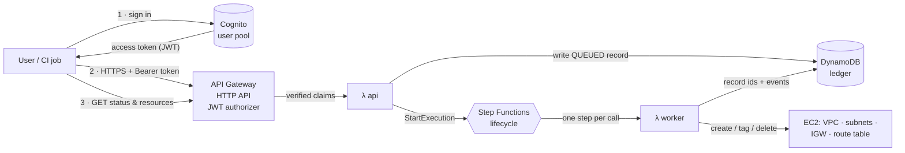
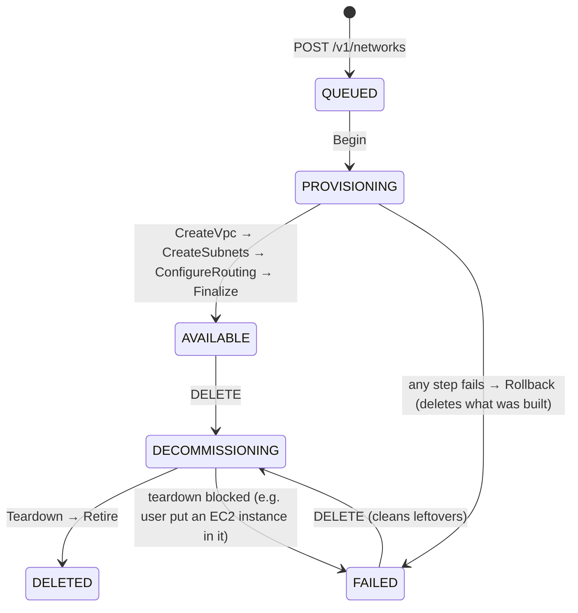

# netloom

An authenticated REST API that **creates AWS VPCs with multiple subnets**, **records every resource it creates**, and lets any signed-in user **retrieve** that data later. It's written in Python and runs entirely on AWS serverless services. Terraform and GitHub Actions deploy it with no stored AWS keys.

```
POST /v1/networks  ──►  202 Accepted (QUEUED)  ──►  Step Functions builds VPC + subnets + IGW
GET  /v1/networks/{id}                          ◄──  AVAILABLE, with every AWS id recorded
```

| Requirement | How netloom meets it |
|---|---|
| API that creates a VPC with multiple subnets | `POST /v1/networks`: list subnets explicitly, or describe a *layout* (tiers × zones) and let the planner carve the CIDRs |
| Store the results | DynamoDB single-table ledger: network, one item per subnet, append-only audit events |
| Retrieve created resources | `GET /v1/networks`, `/{id}`, `/{id}/subnets`, `/{id}/events` |
| Python | Python 3.13 Lambda functions, standard library + boto3 only |
| Authentication layer | Amazon Cognito user pool. API Gateway verifies the JWT before any code runs |
| Authorization open to all authenticated users | One JWT authorizer, no scopes or ownership checks. Writes still record *who* did them |
| Bonus: automation | Terraform for all infrastructure, a bootstrap stack for remote state and GitHub OIDC, and CI/CD that tests, deploys and health-checks |
| Local emulation | The same Terraform module deploys to **LocalStack**: `make local-e2e` runs create → retrieve → delete end to end with no AWS account |

---

## Architecture



**Why it's asynchronous.** Building a VPC takes several dependent EC2 calls. Any of them can be throttled or fail, and a partial failure must be cleaned up. If one HTTP request did all of that, the client would wait on a long call and orphaned resources could be left behind. Here the API only validates, records and enqueues. A Step Functions workflow does the work with retries, back-off and automatic rollback, and the client polls a resource that always reflects the truth.

### Lifecycle



Every step can be retried safely:

- **DynamoDB is the ledger.** Each step reads the record first and skips work that's already recorded.
- **Resources are found by tag.** Everything gets the tags `netloom:managed=true` and `netloom:network-id=<id>` when it's created. If a Lambda dies after EC2 created a VPC but before the id was saved, the retry finds and *adopts* that VPC instead of creating a duplicate. A test covers this case.
- **Errors are classified.** Throttling and `DependencyViolation` raise `RetryableStepError`, which is retried 6 times with jittered exponential back-off. Anything else fails fast and goes to rollback.

More detail and the trade-offs are in [docs/architecture.md](docs/architecture.md).

---

## API

Full contract: [docs/openapi.yaml](docs/openapi.yaml).

| Method & path | Auth | Purpose |
|---|---|---|
| `GET /v1/health` | public | liveness |
| `GET /v1/me` | JWT | shows the identity the API sees (useful in the auth demo) |
| `POST /v1/plans` | JWT | **dry run**: validates a definition and returns the computed subnets without creating anything |
| `POST /v1/networks` | JWT | creates a network → `202` + `Location`; supports the `Idempotency-Key` header |
| `GET /v1/networks?limit&cursor&status` | JWT | lists networks, newest first, with cursor pagination |
| `GET /v1/networks/{id}` | JWT | network + subnets + AWS ids + status |
| `GET /v1/networks/{id}/subnets` | JWT | subnets with `subnet_id`, AZ and usable IPs |
| `GET /v1/networks/{id}/events` | JWT | audit trail: who requested what, and what the workflow did |
| `DELETE /v1/networks/{id}` | JWT | tears it down. The record stays, with status `DELETED` |

### Two ways to describe subnets

**Layout** (tiers × zones). The planner picks consecutive, non-overlapping blocks:

```json
{ "name": "payments-dev", "cidr": "10.20.0.0/16",
  "layout": { "tiers": ["public", "private"], "zones": 3, "prefix": 20 },
  "tags": { "team": "payments" } }
```

→ `public-a 10.20.0.0/20`, `public-b 10.20.16.0/20`, `public-c 10.20.32.0/20`, `private-a 10.20.48.0/20`, … If you leave out `prefix`, it uses the largest size that fits.

**Explicit**:

```json
{ "name": "lab", "cidr": "172.16.0.0/20",
  "subnets": [
    { "name": "web",  "cidr": "172.16.0.0/24",  "zone": "a", "tier": "public"  },
    { "name": "db-a", "cidr": "172.16.8.0/23",  "zone": "a" },
    { "name": "db-b", "cidr": "172.16.10.0/23", "zone": "b" } ] }
```

The planner reports **every** problem at once, each with its field path:

```json
{ "error": { "code": "validation_failed", "message": "The request is not a valid network definition.",
  "details": [ { "field": "subnets[1].cidr", "message": "10.0.0.128/25 overlaps 10.0.0.0/24 (a)" },
               { "field": "subnets[2].cidr", "message": "10.1.0.0/24 is outside the VPC range 10.0.0.0/16" } ] } }
```

What the planner enforces:

- The VPC block must be RFC 1918 and between /16 and /28.
- Subnets must sit inside the VPC, must not overlap, and their names must be unique.
- At most 16 subnets (configurable).
- Tag keys `aws:*`, `netloom:*` and `Name` are reserved.

Zones `a`–`f` are *logical*. They map onto the region's available AZs in sorted order, so the same request works in any region.

**Public tier**: the subnet gets `MapPublicIpOnLaunch`, and the VPC gets an internet gateway and a route table with `0.0.0.0/0 → IGW` associated to the public subnets. **Private tier** gets no internet path. A NAT gateway was left out on purpose to keep the demo free of hourly charges.

---

## Authentication & authorization

- **Who can get a token.** Self sign-up is disabled. Users are invited through Terraform (`invited_users`, and Cognito e-mails them a temporary password) or created by an admin with `make user`. Passwords need at least 12 characters with mixed case and digits. Users can turn on TOTP MFA.
- **Two token types, both accepted:**
  - *Humans*: e-mail + password → access token (the `cli` app client).
  - *Machines*: OAuth2 `client_credentials` with the `netloom/api` scope (the `automation` app client). Use this for CI jobs and other services.
- **Verification** happens in API Gateway's JWT authorizer: signature, issuer, expiry and audience. Requests without a valid token get `401` and never reach Lambda. The Lambda also refuses calls that arrive without claims, as defence in depth.
- **Authorization** is open to all authenticated users, as required. Bob can read and delete Alice's network. A test asserts this. Accountability comes from the audit trail instead: every event records `actor.sub` and `actor.username`.
- **Least privilege in AWS.** The worker can *create* EC2 resources only if the request carries the tag `netloom:managed=true`. It can *modify or delete* only resources that already carry that tag. It can't touch any VPC netloom didn't create.

---

## Repository layout

```
src/netloom/
  api.py           HTTP handler: routing by routeKey, validation, idempotency, 202 flow
  planner.py       pure CIDR planning/validation (also powers the dry-run)
  store.py         DynamoDB single-table repository, optimistic status transitions
  provisioner.py   Step Functions worker: idempotent EC2 steps, tag discovery, rollback
  web.py ids.py errors.py
infra/
  modules/netloom/ the stack itself: Cognito, HTTP API, Lambdas, Step Functions, DynamoDB, IAM
  modules/netloom/tests/  terraform test contract tests (mock providers, offline)
  app/             root for real AWS: provider, S3 backend, module call
  localstack/      root for LocalStack: endpoint overrides, local state, docker-compose.yml
  bootstrap/       one-time: S3 state bucket (native locking) + GitHub OIDC deploy role
scripts/
  netloom_auth.py  add users, sign in, machine tokens (reads terraform outputs)
  smoke_test.sh    end-to-end demo against a live deployment
  local_smoke.py   end-to-end run against the LocalStack deployment
tests/             pytest + moto: planner, API, full lifecycle against mocked EC2
docs/              architecture & decisions, OpenAPI 3.1 spec
.github/workflows  ci.yml (lint, tests, tf validate/test, LocalStack e2e) · deploy.yml (OIDC → plan → apply → health check)
```

---

## Running it

### Prerequisites

You need Python ≥ 3.12, Terraform ≥ 1.10, AWS credentials with admin rights for the one-time bootstrap, and `jq`/`curl` for the smoke test.

### 1. Test locally (no AWS account needed)

```bash
make install     # pip install -r requirements-dev.txt
make check       # ruff + 33 pytest tests (moto) + terraform validate (all roots) + terraform test
```

### 1b. Run the real stack on LocalStack (Docker, no AWS account)

`infra/localstack` deploys the **same Terraform module** that goes to AWS. It points every AWS provider endpoint at `http://localhost:4566`, uses local state and fake credentials, and can't touch a real account.

```bash
export LOCALSTACK_AUTH_TOKEN=...   # free Hobby plan: app.localstack.cloud → Auth Tokens
make local-e2e                     # local-up + local-deploy + local-smoke
make local-down                    # stop it and forget everything
```

`local-smoke` drives the deployed artefacts end to end. It creates a network, then:

- checks the VPC and subnets really exist in emulated EC2;
- retrieves the stored data;
- replays a request with the same idempotency key;
- has a second user read and delete the network;
- prints the audit trail.

The API Lambda, Step Functions workflow, worker Lambda, DynamoDB and EC2 all run inside LocalStack.

**What's emulated differently.** LocalStack's free tier has no Cognito and no API Gateway v2. So the local stack sets `enable_edge = false`, which skips those resources, and the smoke script plays API Gateway's role: it invokes the API Lambda with the exact payload-v2 event API Gateway sends, including the verified JWT claims. Token verification itself is covered by the module's contract tests and by the smoke test on real AWS. If your LocalStack plan includes those services, run `terraform -chdir=infra/localstack apply -var enable_edge=true` to deploy the full edge too.

Notes:

- Since LocalStack 2026.03 the image needs an auth token to start. To try it without one, use the last token-free Community build: `LOCALSTACK_IMAGE=localstack/localstack:4.14 make local-e2e`.
- CI runs the same `make local-e2e` when the repository secret `LOCALSTACK_AUTH_TOKEN` is set.

### 2a. Deploy from your machine

```bash
make bootstrap REPO=<owner>/<repo>    # state bucket + OIDC role; writes infra/app/backend.hcl
make init
cp infra/app/terraform.tfvars.example infra/app/terraform.tfvars   # edit region / invited users
make deploy
make outputs
```

### 2b. Deploy via GitHub Actions

1. Run `make bootstrap REPO=<owner>/<repo>` once. It prints `deploy_role_arn` and `state_bucket`.
2. In GitHub, create an environment named **`aws`**. You can add required reviewers to it.
3. Add these repository variables: `AWS_DEPLOY_ROLE_ARN`, `AWS_REGION`, `TF_STATE_BUCKET`, and optionally `NETLOOM_INVITED_USERS`, e.g. `["reviewer@example.com"]`.
4. Push to `main`. The workflow runs CI → `terraform plan` → `apply` → health check, and checks that requests without a token get `401`.

### 3. Use it

```bash
make user EMAIL=me@example.com                 # create a user (asks for a password)
export API=$(terraform -chdir=infra/app output -raw api_url)
export TOKEN=$(python scripts/netloom_auth.py login --email me@example.com)

curl -s $API/v1/networks -H "Authorization: Bearer $TOKEN" -H 'Content-Type: application/json' \
  -H 'Idempotency-Key: demo-0001' \
  -d '{"name":"demo","cidr":"10.42.0.0/16","layout":{"tiers":["public","private"],"zones":2,"prefix":24}}' | jq

curl -s $API/v1/networks/<id>         -H "Authorization: Bearer $TOKEN" | jq
curl -s $API/v1/networks/<id>/subnets -H "Authorization: Bearer $TOKEN" | jq
curl -s $API/v1/networks/<id>/events  -H "Authorization: Bearer $TOKEN" | jq
```

Or run the whole flow end to end: `make smoke EMAIL=me@example.com`.

For machines: `TOKEN=$(python scripts/netloom_auth.py machine-token)`.

### 4. Clean up

`DELETE` every network through the API first. Terraform doesn't own those VPCs. Then run `make destroy`.

---

## Demo script (≈10 min)

1. **Auth.** `curl $API/v1/networks` → `401`. Get a token, then `GET /v1/me`.
2. **Dry run.** `POST /v1/plans` with a layout and show the carved CIDRs. Then send an overlapping explicit request and show the multi-error `422`.
3. **Create.** `POST /v1/networks` → `202` with `QUEUED`. Open the Step Functions execution in the console and watch the steps.
4. **Retrieve.** `GET /v1/networks/{id}` → `AVAILABLE` with `vpc_id`, `subnet_id`s and AZs. Cross-check them in the VPC console. Show `/events`.
5. **Idempotency.** Repeat the same POST with the same key → same id, `Idempotent-Replayed: true`.
6. **Open authorization.** Sign in as a second user, list networks, and see the first user's network.
7. **Teardown.** `DELETE` → `DECOMMISSIONING` → `DELETED`. The VPC is gone and the record and audit trail remain.

---

## Operations

- **Observability**:
  - Lambda logs are structured JSON.
  - API Gateway writes JSON access logs that include the caller's `sub`.
  - X-Ray tracing is on for both Lambdas and Step Functions.
  - Workflow errors are logged in CloudWatch.
- **Throttling**: by default the stage allows 20 req/s with bursts of 40 (`api_throttle_*`).
- **Data**: DynamoDB on demand, with point-in-time recovery and encryption. Idempotency records expire through TTL. Set `protect_data=true` for deletion protection on the table and the user pool.
- **Cost at rest**: close to $0. Everything is pay-per-request, and the VPCs and subnets created are free. The deliberately absent NAT gateway would be the first real cost.

## Known limitations / next steps

- IPv4 only. Planned next: an IPv6 `/56` per VPC and a `/64` per subnet.
- One region per deployment (the API's own region).
- No NAT for private tiers. Planned as an opt-in `nat: "single" | "per-zone"`.
- `status` filtering on lists is applied after DynamoDB's page limit, so a page can come back with fewer items than `limit`. A status GSI would fix that if needed.
- If a user puts their own resources (ENIs, instances) into a netloom VPC, teardown can't delete it. Teardown then retries and ends `FAILED` with `DependencyViolation` in the events. Remove those resources and call `DELETE` again.
