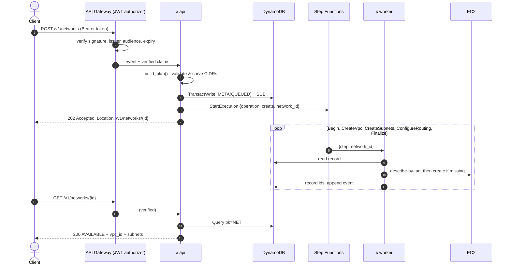

# Architecture & design decisions

## Request flow

## Data model (single table)

| pk | sk | content |
|---|---|---|
| `NET#<id>` | `META` | name, cidr, region, tags, status, vpc_id, internet_gateway_id, public_route_table_id, created_by, timestamps, execution_arn, error |
| `NET#<id>` | `SUB#<key>` | name, cidr, zone, tier, usable_ips, state, subnet_id, availability_zone |
| `NET#<id>` | `EVT#<ts>#<rand>` | at, type, message, actor |
| `IDEM##<key>` | `IDEM` | network_id, request fingerprint, `expires_at` (TTL) |

- A single `Query` on `pk` returns a network with all of its subnets and events. There's no scan and no join.
- GSI `by_kind` (`kind`, `id`) handles listing. Network ids are time-ordered base32, so sorting by id descending gives "newest first" without a separate timestamp key.
- Only `META` items carry `kind`, which keeps the GSI sparse.

## Key decisions

| Decision | Alternatives considered | Why |
|---|---|---|
| Asynchronous 202 + Step Functions | Synchronous Lambda; SQS + worker | The work has several dependent steps that can each fail. Step Functions gives retries, back-off, a rollback branch and a visual execution history for free, which also helps in a demo. |
| One worker Lambda dispatched by `step` | One Lambda per step | Shares code and IAM, gives one deployment unit, and the steps stay individually retryable. |
| DynamoDB as the ledger; the state machine carries only `network_id` | Pass state between steps | Every step re-reads the truth, so retries and manual re-runs are safe, and state payloads stay tiny. |
| Find resources by tag | Trust only the recorded ids | Handles the "created but not recorded" crash window, and teardown cleans up even resources that were never recorded. |
| HTTP API + native JWT authorizer | REST API + Cognito authorizer; Lambda authorizer | It's cheaper and faster, needs no custom auth code, and Lambda is never invoked for unauthenticated traffic. |
| Two Cognito clients (password and client_credentials) | Humans only | CI pipelines and other services can call the API without a human account. |
| Planner as a pure module + `POST /v1/plans` | Validate only on create | Fully unit-tested without AWS, and users can preview the CIDR carve before committing. |
| Idempotency-Key header | None | Network clients retry. Without a key, a retried POST would create a second VPC. |
| Optimistic status transitions (`ConditionExpression status IN (...)`) | Locks | Prevents double-delete and delete-while-provisioning with a single conditional write. |
| Tag-conditioned IAM | `ec2:*` | The worker can't modify or delete VPCs it didn't create. |
| Terraform + S3 native lockfile + GitHub OIDC | SAM/CDK; DynamoDB lock table; stored access keys | Terraform was requested, native locking removes a table, and OIDC means no long-lived credentials exist anywhere. |
| No third-party runtime dependencies | FastAPI/Powertools/Pydantic | The zip is tens of KB, cold starts are faster, and there are no layers or supply-chain surface to manage. |

## Failure handling

| Situation | Behaviour |
|---|---|
| EC2 throttling, `DependencyViolation` | `RetryableStepError` → retried 6× with jittered exponential back-off |
| Permanent EC2 error (e.g. `VpcLimitExceeded`) | Rollback deletes everything tagged for the network → `FAILED`, with the error code and message on the record |
| Rollback itself fails | Logged as a `rollback_incomplete` event. The original error is still the one reported. Calling `DELETE` retries the cleanup |
| `StartExecution` fails after the record was written | Record marked `FAILED` (`WorkflowStartFailed`) and the API returns 500 |
| Two DELETEs at once | The second gets `409` thanks to the conditional status transition |
| Workflow exceeds 30 min | Execution times out and the record stays in its last status. Visible in the console. Calling `DELETE` (on FAILED) cleans up |

## Security summary

- **Authentication.** TLS-only API. Tokens are verified by API Gateway, there's no self sign-up, and the password policy is strict with optional MFA.
- **Authorization.** Open to every authenticated user, as the brief requires, and audited per action.
- **Least-privilege roles.** The api role can use DynamoDB and start the one state machine. The worker role is tag-scoped on EC2 and has DynamoDB access. The workflow role can invoke the worker and deliver logs. The deploy role is limited to `netloom-*` roles and the services the stack uses.
- **State and data.** The state bucket is versioned, encrypted, TLS-only and blocks public access. The table is encrypted and has point-in-time recovery.
- **Input handling.** The body is capped at 32 KB, path ids are validated against a strict pattern before any lookup, and 500 responses never leak internals.
